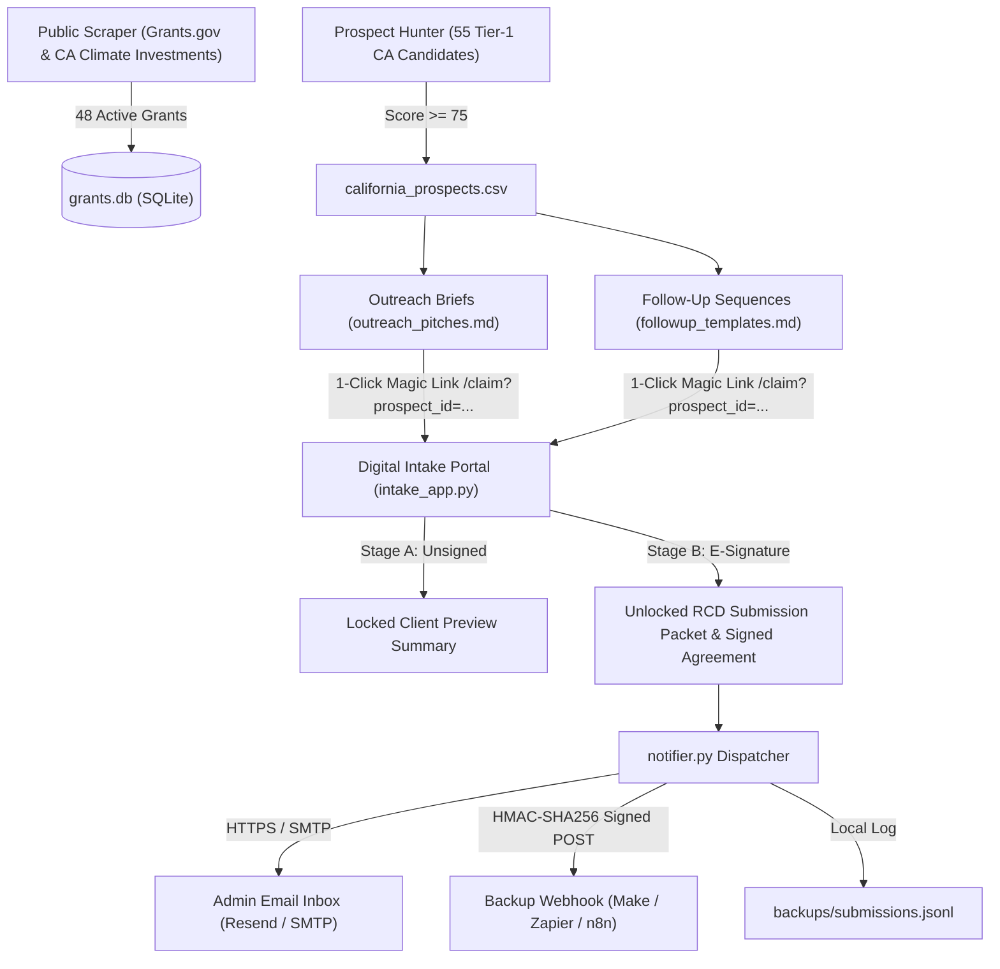

# ZYS GoldFields PRO LLC — Conservation Grant Hunter, E-Signature & Zero-Call Intake Portal

[](https://render.com/deploy?repo=https://github.com/yellowrabbit17/zys-goldfields-intake)

End-to-end automated California conservation grant underwriting, Tier-1 prospect qualification, 1-page cold-outreach pitch generation, California UETA / ESIGN e-signature execution (`2 CFR § 200.459` compliant), and "Sign-to-Unlock" County Resource Conservation District (RCD) / USDA NRCS submission packaging.

## Production Hardening Upgrades

1. **Ephemeral Database Protection & Off-Host Notifications (`notifier.py`, `intake_app.py`)**:
   - **Render Ephemeral Disk Resilience**: Free tier container resets wipe SQLite upon redeployment. Every client intake and e-signature event is immediately duplicated off-host:
     - **Email with Attachments**: Transmits `signed_advisory_agreement.md`, `client_submission_packet.md`, and `esignature_audit_record.json` directly to your admin inbox via **Resend** (HTTPS API) or standard **SMTP**.
     - **Persistent Backup Webhook**: Dispatches full payload and document contents to any webhook endpoint (Make, Zapier, n8n, Pipedream, Google Apps Script) with cryptographic **HMAC-SHA256 signature** (`X-ZYS-Signature: sha256=<hex>`) when `BACKUP_WEBHOOK_SECRET` is set.
     - **Local Journal**: Records all events in `backups/submissions.jsonl`.
   - **24/7 Keep-Alive Endpoint (`/healthz`)**:
     - Fast zero-DB `GET` and `HEAD` `/healthz` returning `200 ok` in under 1ms, purpose-built for free cron pingers (e.g., [UptimeRobot](https://uptimerobot.com) or [cron-job.org](https://cron-job.org)) to keep your Render web service awake without sleep cycles.

2. **1-Click Pre-Filled Magic Links (`/claim?prospect_id=...`)**:
   - Intake portal accepts `/claim?prospect_id=CA-T1-###` query parameters.
   - Pre-fills Organization Name, County, EIN, Acreage, and Top Matched Grant directly from `california_prospects.csv` (which is tracked in git and always available even on fresh container boots).
   - Replaces the multi-step "Reply READY" funnel with a direct 1-click CTA: prospects click their custom magic link, verify their parcel APN, e-sign in 30 seconds, and immediately unlock their filing packet.

3. **Statutory Tiering, Land Trust Segmentation & CAN-SPAM Compliance (`matcher.py`, `legal_agreement.py`)**:
   - **Client-Facing Language**: Preserves the 0–100 numerical score internally in `california_prospects.csv`, but displays it in client correspondence as `"Tier-1 Statutory Eligibility Match (4/4 Core Criteria Met)"`.
   - **Land Trust Channel Segmentation**: Automatically categorizes Land Trusts as `Channel_Partner` (co-sponsorship & acquisition/easement co-application copy) vs. Sanctuaries and Working Ranches as `Direct_Client` (turnkey direct filing copy).
   - **Contingency Fee Phrasing & 2 CFR § 200.459**: Phrased as a `"7% Deferred Administrative Origination & Packaging Fee (100% Waived if Grant is Not Awarded)"`, billed strictly to non-grant operating funds and never deducted from restricted grant proceeds.
   - **CAL FIRE RPF & RCD Coordination Disclosure**: Clear disclosures noting RPF plan sign-off and County RCD coordination.
   - **CAN-SPAM Compliant Follow-Ups (`followup_templates.md`)**: Complete Day 4 (Staged Packet Reminder) and Day 9 (Agency Urgency Notice) automated follow-up email sequences for all 55 Tier-1 prospects, complete with unsubscribe instructions and advertising disclosures.

## Architecture & Data Flow



## Environment Variables for Render

Configure these in the Render Dashboard (**Environment** tab):

| Variable | Description | Example / Default |
| :--- | :--- | :--- |
| `PUBLIC_MODE` | Enables production security (protects admin API endpoints) | `1` |
| `ADMIN_API_TOKEN` | Bearer token to access `/api/intakes`, `/api/audits`, `/api/prospects` | `zys_admin_sec_...` |
| `ADMIN_NOTIFICATION_EMAIL` | Destination email to receive signed agreements & packets | `admin@zysgoldfields.com` |
| `NOTIFICATION_FROM_EMAIL` | Sender email address for notifications | `grants@zysgoldfields.com` |
| `NOTIFICATION_PROVIDER` | Email provider: `resend`, `smtp`, or `auto` | `auto` |
| `RESEND_API_KEY` | Resend API key (if using Resend HTTPS delivery) | `re_123456789...` |
| `SMTP_HOST` | SMTP server host (if using SMTP) | `smtp.mailgun.org` |
| `SMTP_PORT` | SMTP port | `587` |
| `SMTP_USE_TLS` | SMTP TLS encryption | `true` |
| `SMTP_USERNAME` | SMTP username | `postmaster@...` |
| `SMTP_PASSWORD` | SMTP password | `...` |
| `BACKUP_WEBHOOK_URL` | Webhook to receive intake JSON + document backups | `https://hook.us1.make.com/...` |
| `BACKUP_WEBHOOK_SECRET` | Secret key used for HMAC-SHA256 request signing | `whsec_...` |

> [!NOTE]
> **CAN-SPAM Mailing Address Requirement**: Before sending cold outreach pitches or follow-up sequences from `outreach_pitches.md` or `followup_templates.md`, set your firm's valid physical postal address in `config.json` under `"firm_postal_address"` (or configure your outbound email marketing tool) to comply with 15 U.S.C. § 7704(a)(5).

## Verification & Pipeline Execution

```bash
python3 -m venv venv
./venv/bin/pip install -r requirements.txt
./venv/bin/python run_pipeline.py
```

To run the local portal server:
```bash
./venv/bin/python intake_app.py --host 0.0.0.0 --port 8080
```
