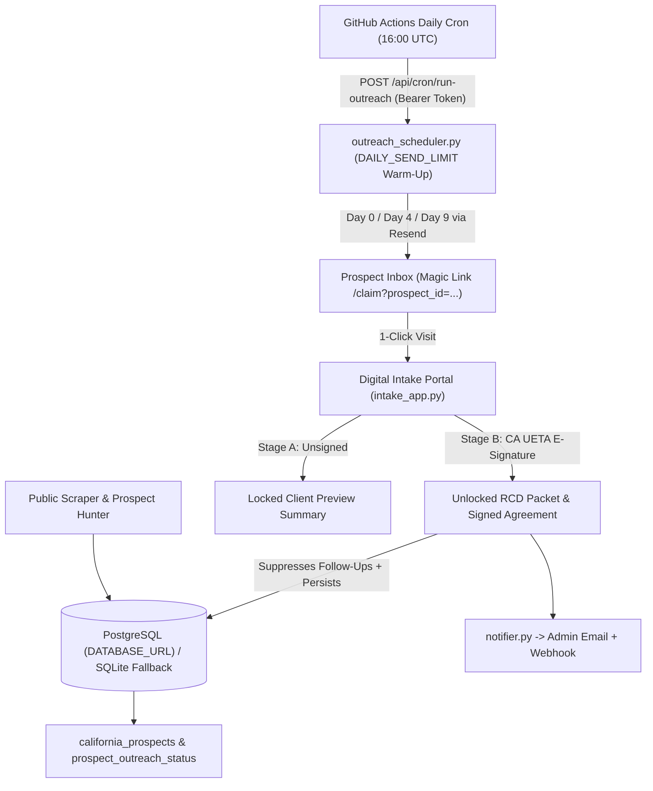

# ZYS GoldFields PRO LLC — Conservation Grant Hunter, E-Signature & Zero-Call Intake Portal

[](https://render.com/deploy?repo=https://github.com/yellowrabbit17/zys-goldfields-intake)

End-to-end automated California conservation grant underwriting, Tier-1 prospect qualification, 1-page cold-outreach pitch generation, California UETA / ESIGN e-signature execution (`2 CFR § 200.459` compliant), "Sign-to-Unlock" County Resource Conservation District (RCD) / USDA NRCS submission packaging, persistent PostgreSQL storage, custom domain routing (`portal.zysgoldfields.pro`), and warm-up rate-limited Day 4 / Day 9 follow-up automation.

## Production Hardening Upgrades

1. **Persistent PostgreSQL Storage & Startup Migrations (`db.py`, `intake_app.py`)**:
   - **Dual-Backend Database Layer**: Supports any managed **PostgreSQL** instance via `DATABASE_URL` (`psycopg2-binary`, e.g., Neon, Supabase, or Render PostgreSQL) and falls back cleanly to local SQLite (`grants.db`) only when `DATABASE_URL` is unset.
   - **Automatic Migrations & Cold-DB Bootstrapping**: Runs schema DDL and `ALTER TABLE ... ADD COLUMN IF NOT EXISTS` migrations automatically on startup, and seeds `grants`, `landowner_profiles`, `california_prospects`, and `prospect_outreach_status` from `california_prospects.csv` on fresh databases so signed agreements, intake packets, and outreach tracking survive every Render redeploy.
   - **Resilient Download Fallback**: Even if ephemeral container local disk files (`packets/*.md`) are cleared on restart, `/api/packet/<id>`, `/api/preview/<id>`, and `/api/agreement/<id>` reconstruct exact Markdown dossiers on-the-fly from persisted PostgreSQL records (while enforcing the Sign-to-Unlock gate).

2. **Off-Host Redundant Backups & Keep-Alive (`notifier.py`, `intake_app.py`)**:
   - **Transactional Email with Attachments**: Immediately dispatches `signed_advisory_agreement.md`, `esignature_audit_record.json`, and `client_submission_packet.md` to your admin inbox via **Resend** (HTTPS API) or **SMTP** from `grants@zysgoldfields.pro`.
   - **Persistent Backup Webhook**: Optional HMAC-SHA256 signed JSON webhook (`X-ZYS-Signature: sha256=<hex>`) to Make / Zapier / n8n / Google Apps Script.
   - **24/7 Keep-Alive Endpoint (`/healthz`)** and **Diagnostic Check (`/api/health`, `/api/test-email`)**: Fast zero-DB `GET`/`HEAD /healthz` plus rich health diagnostics reporting database backend persistence, active `BASE_URL`, `DAILY_SEND_LIMIT`, and email readiness.

3. **Custom Domain Support & 1-Click Magic Links (`models.py`, `matcher.py`, `prospect_hunter.py`, `intake_app.py`)**:
   - **Configurable `BASE_URL`**: Set `BASE_URL=https://portal.zysgoldfields.pro` in Render Environment (falls back cleanly to `https://zys-goldfields-intake.onrender.com` until DNS CNAME is pointed). Dynamically updates all `/claim?prospect_id=...` magic links, outreach batches, canonical `<link>` tags, and portal metadata.
   - **1-Click Pre-Filled Experience (`/claim?prospect_id=CA-T1-###`)**: Pre-fills Organization Name, County, EIN, Acreage, Conservation Focus, and Top Matched Grant from PostgreSQL/`california_prospects.csv`. Prospects verify their parcel APN, e-sign, and unlock their RCD filing packet in 1 click.

4. **Automated Day 4 & Day 9 Outreach Scheduler + Warm-Up Rate Limiting (`outreach_scheduler.py`, `.github/workflows/outreach_cron.yml`)**:
   - **Protected Cron Endpoint (`/api/cron/run-outreach`)**: Strictly secured by `ADMIN_API_TOKEN` (`Authorization: Bearer ...`), triggered daily at `16:00 UTC` (8 AM PST / 9 AM PDT) via GitHub Actions with Render cold-start retries.
   - **Safe Domain Warm-Up Rate Limiting (`DAILY_SEND_LIMIT`)**: Caps total daily combined Day 0 / Day 4 / Day 9 emails (default `8`/day) and tracks exact per-day UTC send volume in `outreach_send_log`.
   - **Priority Cadence, Idempotency & Suppression**: Processes `Day 9 Follow-Up` -> `Day 4 Follow-Up` -> `Day 0 Initial Brief`, enforces atomic `(prospect_id, sequence_step)` database locks so no prospect is ever emailed twice for the same cadence step, and automatically suppresses any prospect who claims/signs on the portal or unsubscribes (`/api/outreach/mark`).

5. **Statutory Tiering, Land Trust Segmentation & CAN-SPAM Compliance (`matcher.py`, `legal_agreement.py`)**:
   - Client correspondence translates internal scores into `"Tier-1 Statutory Eligibility Match (4/4 Core Criteria Met)"`, segments `Land Trust` (`Channel_Partner`) vs. Sanctuaries/Ranches (`Direct_Client`), phrases the 7% fee as a `"7% Deferred Administrative Origination & Packaging Fee (100% Waived if Grant is Not Awarded)"` (`2 CFR § 200.459`), and embeds the CAN-SPAM physical address (`8698 Elk Grove Blvd Ste 1-279 Elk Grove CA 95624`) and unsubscribe disclosures in `outreach_pitches.md` and `followup_templates.md`.

## Architecture & Data Flow



## Environment Configuration (`.env.example`)

Copy `.env.example` to `.env` for local testing or configure these variables in Render Dashboard -> **Environment** (and `ADMIN_API_TOKEN` + `PORTAL_BASE_URL` in GitHub Repo Settings -> **Secrets and variables -> Actions**):

| Variable | Description | Example / Default |
| :--- | :--- | :--- |
| `PUBLIC_MODE` | Enables production security on admin API routes | `1` |
| `BASE_URL` | Canonical portal URL for magic links (`portal.zysgoldfields.pro` once DNS is active) | `https://zys-goldfields-intake.onrender.com` |
| `DATABASE_URL` | Persistent PostgreSQL connection string (Neon / Supabase); omit locally for SQLite | `postgresql://...?sslmode=require` |
| `ADMIN_API_TOKEN` | Bearer token protecting `/api/cron/run-outreach`, `/api/outreach-status`, `/api/intakes`, `/api/audits` | `zys_admin_...` |
| `DAILY_SEND_LIMIT` | Safe daily domain warm-up cap across Day 0/4/9 batches | `8` |
| `NOTIFICATION_PROVIDER` | Email provider (`resend`, `smtp`, or `auto`) | `resend` |
| `RESEND_API_KEY` | Resend HTTPS API key | `re_...` |
| `ADMIN_NOTIFICATION_EMAIL` | Destination admin inbox | `Ksandzhar@gmail.com` |
| `NOTIFICATION_FROM_EMAIL` | Verified sender email address | `grants@zysgoldfields.pro` |
| `BACKUP_WEBHOOK_URL` | Optional persistent JSON webhook | `https://hook.us1.make.com/...` |
| `BACKUP_WEBHOOK_SECRET` | Optional HMAC-SHA256 secret for webhook requests | `whsec_...` |

## Verification & Pipeline Execution

```bash
python3 -m venv venv
./venv/bin/pip install -r requirements.txt
./venv/bin/python run_pipeline.py
```

To run the local portal server:
```bash
./venv/bin/python intake_app.py --host 0.0.0.0 --port 8080
```
